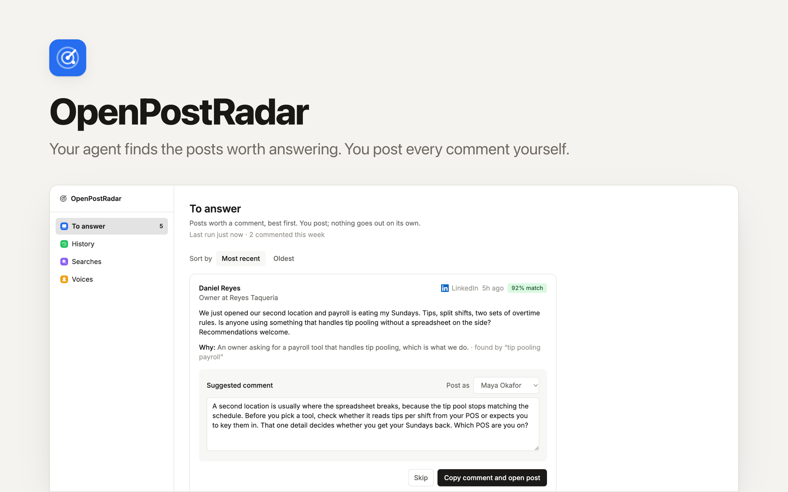
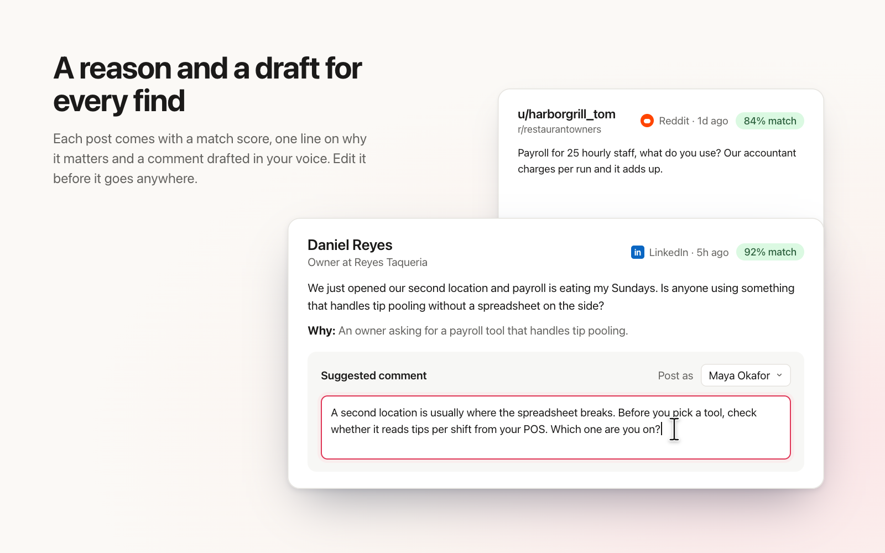
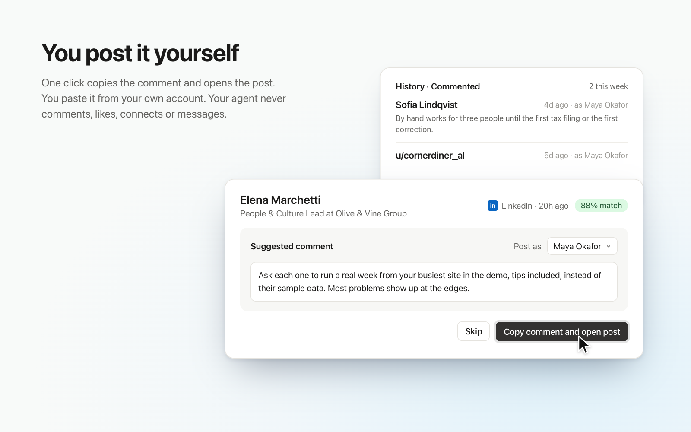
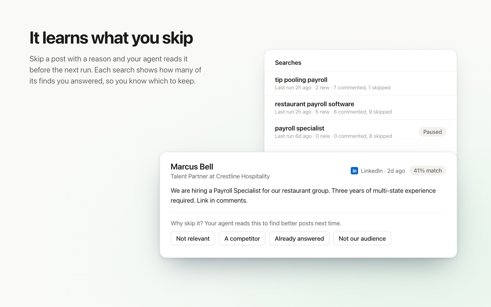
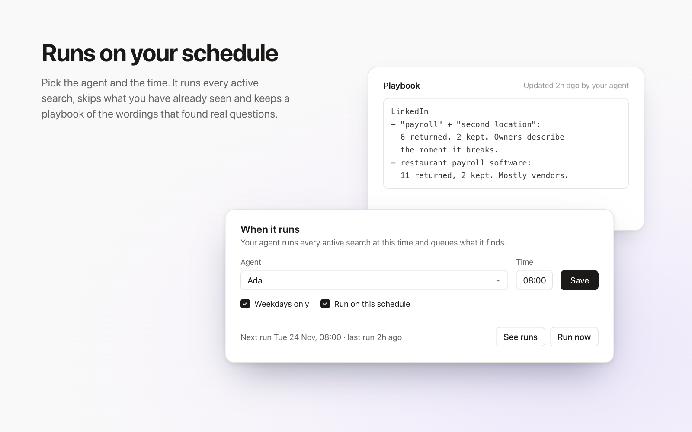

<picture>
  <source media="(prefers-color-scheme: dark)" srcset="readme-banner-dark.png" />
  
</picture>

# OpenPostRadar: The Open-Source Social Listening Tool for Finding Posts Worth Answering

[](https://app.clawnify.com/deploy?repo=clawnify/OpenPostRadar)

Your agent searches LinkedIn for people asking about what you do, skips every post you have already seen, and queues each find with why it matters, a drafted comment and who should post it. You post the comment yourself: nothing goes out on its own. An open-source app template provided by [Clawnify.com](https://clawnify.com).

Think of it as an open-source alternative to social listening tools like **Brand24**, built for one job: finding the conversations worth joining. There is no per-keyword plan, so you add as many searches as you want.

Built with **React + Tailwind** on a **Hono API** and a **SQLite** database, with a full OpenAPI surface so an agent can drive it.

## See it in action

Conceptual UI illustrations of the app's main capabilities, with fictional example data. Open an image to see the details.

| A reason and a draft for every find | You post it yourself |
|---|---|
| [](previews/draft.png) | [](previews/post.png) |
| **It learns what you skip** | **Runs on your schedule** |
| [](previews/learn.png) | [](previews/schedule.png) |

## What it does

Answering the right post at the right moment is one of the cheapest ways to get in front of a buyer, and one of the most tedious: search, scroll, open, judge, write, repeat, every day. OpenPostRadar splits that work:

- **Your agent does the searching.** For each search it starts from your words, tries up to two wordings of its own, reads every post in full and scores it against what you said you hope to find.
- **You keep the judgement, and the account.** Each find arrives with a relevance score, a one-line reason, a drafted comment and a suggested voice. You edit it, copy it, open the post and comment as yourself. The agent never comments, likes, connects or messages.
- **The app keeps the record.** A post is identified by its link, so nothing is queued twice and a post you skipped stays skipped. History shows what you commented and what you skipped, with the reason.
- **It gets better at your taste.** The agent reads your edits and your skip reasons before its next run, and keeps a short playbook of the wordings that found real asks. You can read and edit that playbook.

It is built for LinkedIn first. A search can target Reddit instead by setting its `platform` through the API, and each card shows which of the two a post came from.

## How it works

1. **Say who comments.** Add your company page and each person who answers for it, with a line on how they talk. Every suggestion names one, because the same reply lands differently from a founder than from a logo.
2. **Tell it what to look for.** A few short searches, each with a line on what a good find looks like ("people asking who can help them with X" beats "X").
3. **Schedule it.** Pick the agent and the time it runs, on weekdays or every day. You can also run everything now, or one search on its own.
4. **Work the queue.** Read the post and the reason, edit the comment, copy it and open the post. Mark it commented, or skip it with a reason.
5. **Check what works.** Each search shows how many of its finds you commented on and how many you skipped, so you can see which ones are worth keeping.

## What it deliberately doesn't do

- **It doesn't post for you.** No comment, like, reaction, connection request or message ever leaves the app or the agent. A person posts every comment from their own account.
- **It doesn't hammer the platforms.** The agent guide keeps it to one tab, one search at a time, a handful of posts opened per run and at most 15 added to the queue a day. If a platform shows a security check or a login prompt, the agent stops using its pages for that run and tells you.
- **It doesn't call a model.** The app stores, deduplicates and schedules. The reading, scoring and drafting are your agent's work, so the app costs nothing to run on its own.

## Running it

On Clawnify, deploy it with the button above, add your voices and searches, then pick the agent and the time on the **Searches** page.

Locally:

```bash
pnpm install
pnpm dev          # UI on :5173, API on :8787
pnpm test
```

Outside Clawnify there is no scheduler, so ask your own agent to run it: [`agent.md`](agent.md) is the full procedure, and the API describes itself at `/api/openapi.json` and `/llms.txt`.

## License

MIT
